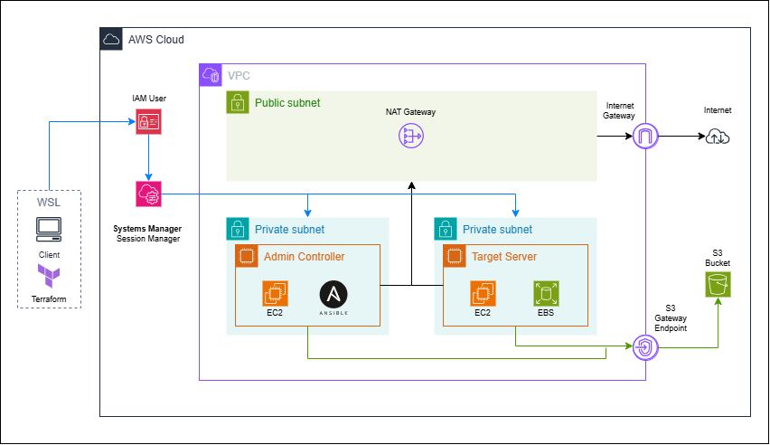

# Project 1B — Proactive Linux Server Hardening

**Meridian Digital Services is fictional.** This project demonstrates how I prepared a private Ubuntu EC2 server for restricted SFTP use before placing it into service. The workload used synthetic files only.

> I built a private AWS lab with Terraform, managed the target through AWS Systems Manager, restricted the SFTP identity to a chrooted upload directory, and applied host firewall, audit, AppArmor, unattended-upgrade, SSH, and kernel network controls. I verified allowed and denied access paths, then destroyed the lab infrastructure.

## Problem and outcome

The target needed to accept file transfers without becoming a general-purpose SSH server or exposing TCP 22 to the internet. The security group had no ingress rules, but the SSH service still listened inside the instance; therefore network isolation alone did not constrain what an authenticated account could do.

The solution separated management from workload access:

- Administrators used Systems Manager Session Manager; neither EC2 node had a public IP or inbound security-group rule.
- A dedicated key-authenticated `sftpdata` account was placed in the `sftp-only` group, chrooted to a separate encrypted data volume, and forced to use `internal-sftp`.
- The account started in `/upload`, could transfer files there, and could not obtain a shell, escape the chroot, or write to the chroot root.
- UFW denied inbound traffic by default. Auditd watched identity, sudo, SSH, and firewall configuration. AppArmor and unattended upgrades were enabled, and selected kernel/network settings were persisted.
- SFTP remained available through an SSM port-forwarding session after the firewall was enabled.

## Architecture



[View the editable draw.io diagram](docs/aws-infrastructure.drawio).

```text
Workstation (Terraform + AWS CLI)
        |
        | Session Manager
        v
Private admin EC2 (Ansible controller)
        |
        | amazon.aws.aws_ssm + private S3 transfer bucket
        v
Private target EC2 (Ubuntu 24.04, SFTP-only workload)
        |
        +-- encrypted 20 GiB root EBS volume
        +-- encrypted 5 GiB SFTP data volume mounted at /srv/sftp-data

Both EC2 nodes: no public IP, no inbound security-group rules, IMDSv2 required
Private subnet egress: NAT Gateway; S3 transfer traffic: S3 Gateway endpoint
```

The lab used one Availability Zone and one NAT Gateway to control complexity. It was a learning environment, not a high-availability production design.

## Controls implemented

| Area | Implementation |
| --- | --- |
| Network | Private EC2 placement, no public addresses, no security-group ingress, outbound HTTPS only, NAT for egress, S3 Gateway endpoint for transfer traffic |
| AWS access | Session Manager for operator access; minimal agent permissions; separate admin permissions scoped to the target and temporary Ansible transfer bucket |
| Instance metadata and storage | IMDSv2 required; encrypted gp3 root volumes and a separate encrypted target data volume |
| SSH/SFTP | Root and password login disabled; SFTP-only group chroot; key-only identity; no shell, TTY, tunnel, or TCP forwarding for the SFTP user |
| Host firewall | UFW enabled at boot, default deny incoming, default allow outgoing, IPv6 enabled, low logging |
| Host monitoring | Auditd watches account, sudo, SSH, and UFW configuration; log rotation and disk safeguards configured |
| Host baseline | AppArmor enabled; unattended upgrades enabled; selected ASLR, pointer, redirect, source-route, reverse-path, and SYN-cookie settings verified |
| Lifecycle | Terraform destroy after the demonstration; Terraform state list was empty afterward |

## Verification highlights

- Ansible configuration recap: `ok=17 changed=3 unreachable=0 failed=0`.
- SFTP upload and download through an SSM port-forward succeeded; the source and downloaded file SHA-256 hashes matched.
- The SFTP session opened in `/upload`; attempts to access the target's real `/etc`, write at the chroot root, and execute a remote shell command were denied.
- UFW was active with `deny (incoming)` and `allow (outgoing)`. SSM access and SFTP still worked after enabling it.
- AppArmor and unattended-upgrades were enabled and active. Auditd loaded all nine expected watch rules; a harmless test file create/delete under `/etc/ufw` appeared in the audit log.
- `systemctl --failed --no-pager` reported no failed units.
- The final Terraform destroy reported `Resources: 1 destroyed`; `terraform state list` returned no resources. Direct EC2 checks showed the instances terminated and NAT gateway deleted. The S3 list verification was unavailable during the endpoint connectivity error.

See [verification evidence](docs/verification.md), [design decisions](docs/decisions.md), and the [step-by-step walkthrough](docs/step-by-step-lab-walkthrough.md).

## Repository layout

```text
terraform/                 AWS network, IAM, S3, EC2, and encrypted EBS definitions
ansible/playbooks/         Original lab playbooks and a separate reproducibility playbook
ansible/inventory/         Safe inventory example; replace lab-specific values
ansible/requirements.yml   Required Ansible collections
docs/                      Walkthrough, decisions, and verification record
evidence/                  Sanitized text evidence from the lab
```

The actual Terraform source and provider lockfile are included. The Ansible folder contains these playbooks from the lab commands:

| Playbook | Purpose |
| --- | --- |
| [check-updates.yml](ansible/playbooks/check-updates.yml) | List pending target package updates |
| [update-packages.yml](ansible/playbooks/update-packages.yml) | Apply a safe target package upgrade |
| [audit-ssh.yml](ansible/playbooks/audit-ssh.yml) | Check SSH service state and TCP listeners |
| [check-ssh-socket.yml](ansible/playbooks/check-ssh-socket.yml) | Inspect SSH socket activation |
| [audit-sshd-config.yml](ansible/playbooks/audit-sshd-config.yml) | Attempt to read effective SSH settings; this run stopped because `/run/sshd` was missing |
| [audit-sshd-files.yml](ansible/playbooks/audit-sshd-files.yml) | Read SSH configuration files |
| [configure-sftp.yml](ansible/playbooks/configure-sftp.yml) | Configure the restricted SFTP account and SSH policy; this is the playbook whose successful run reported `ok=17 changed=3` |

[harden-target.yml](ansible/playbooks/harden-target.yml) is a separate reproducibility playbook reconstructed from the final target configuration. It was syntax-checked as repository content but was not the file used for the original successful run.

## Re-run the lab

This creates billable AWS resources. Review the cost implications and the Terraform plan before applying it. Use a dedicated lab AWS profile with MFA and appropriate permissions; do not use the account root identity.

```bash
cd terraform
cp terraform.tfvars.example terraform.tfvars
export AWS_PROFILE=your-lab-profile
terraform init
terraform fmt -check -recursive
terraform validate
terraform plan
terraform apply
```

Copy `ansible/inventory/hosts.example.yml` to `ansible/inventory/hosts.yml`, then fill in the Terraform target ID and transfer-bucket output. Install the required collections on the admin node, stage only the SFTP public key there, and run the playbook as described in the walkthrough.

Do not commit private keys, credentials, actual customer files, Terraform state, generated plans, or environment-specific `terraform.tfvars`. The `.gitignore` excludes these local artifacts; still review every change before committing.

## Cleanup

The transfer bucket must be empty before Terraform can delete it. Remove only temporary objects belonging to this lab bucket, then run:

```bash
terraform destroy
terraform state list
```

The recorded demonstration was torn down after testing. Re-running the deployment requires a new `terraform apply`.

